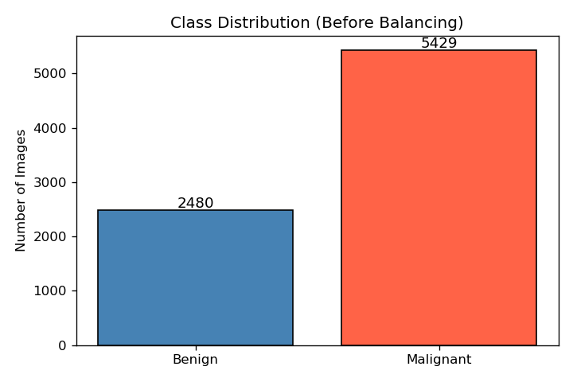
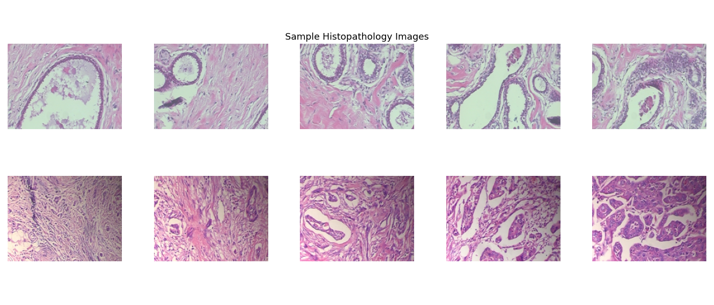
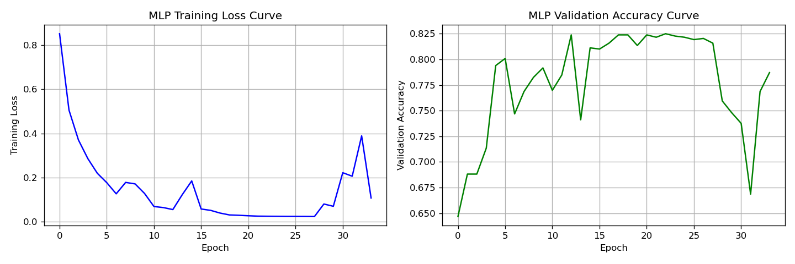
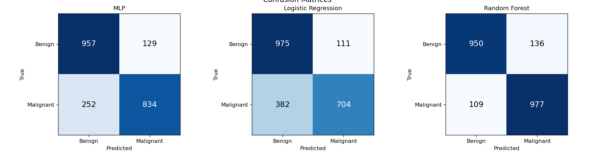
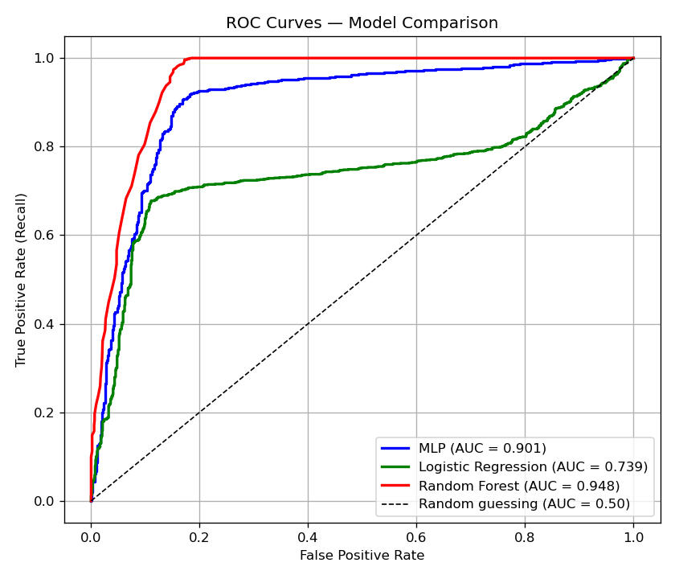

# Breast Cancer Detection: Benign vs. Malignant

A machine learning project that classifies breast tissue histopathology images as benign or malignant. The main model is a Multilayer Perceptron (MLP), compared against Logistic Regression and Random Forest baselines.

## Dataset

**BreaKHis v1**: 7,909 microscopy images of breast tumor tissue at four magnification levels.

- Benign: 2,480 images
- Malignant: 5,429 images

The dataset is not included in this repo. Get it from the official source, the Laboratory of Vision, Robotics and Imaging (UFPR):

- Dataset page: https://web.inf.ufpr.br/vri/databases/breast-cancer-histopathological-database-breakhis/
- Direct download: http://www.inf.ufpr.br/vri/databases/BreaKHis_v1.tar.gz

This repo only contains the script and this README, so the data lives wherever you download it. Extract the archive anywhere you like. The script needs the path to the `histology_slides/breast` folder inside it, which contains the `benign` and `malignant` subfolders:

```
BreaKHis_v1/
    histology_slides/
        breast/
            benign/
            malignant/
```

BreaKHis may be used for non commercial research if you cite the original paper:

> Spanhol, F., Oliveira, L. S., Petitjean, C., Heutte, L. "A Dataset for Breast Cancer Histopathological Image Classification." IEEE Transactions on Biomedical Engineering (TBME), 63(7):1455-1462, 2016.

## Pipeline

1. Load every PNG, convert to grayscale, resize to 64x64, and flatten to 4,096 features
2. Normalize pixel values to the range 0 to 1
3. Oversample the benign class (with replacement) to fix the roughly 31/69 class imbalance
4. Split 80/20 into train and test sets, stratified by class
5. Standardize features with StandardScaler (fit on training data only)
6. Train and evaluate three models

## Models

| Model | Notes |
|---|---|
| MLP (primary) | Two hidden layers (256, 128), ReLU, L2 regularization (alpha=0.01), early stopping |
| Logistic Regression | Linear baseline, uses standardized features |
| Random Forest | 100 trees, uses raw normalized features (no scaling needed) |

## Evaluation

Each model is scored on accuracy, precision, recall, and F1. Recall on the malignant class matters most here, since a missed cancer (false negative) is the worst error. The script also produces confusion matrices and ROC curves with AUC for all three models.

## Results

All three models were evaluated on the same held out test set (2,172 images, 1,086 benign and 1,086 malignant). Precision and recall are for the malignant class.

| Model | Accuracy | Precision | Recall | F1 Score | AUC |
|---|---|---|---|---|---|
| MLP (256, 128) | 82.46% | 86.60% | 76.80% | 0.8141 | 0.901 |
| Logistic Regression | 77.30% | 86.38% | 64.83% | 0.7407 | 0.739 |
| Random Forest | 88.72% | 87.78% | 89.96% | 0.8886 | 0.948 |

Random Forest was the best model overall. It had the highest accuracy, recall, F1, and AUC, and it missed the fewest cancer cases (109 of 1,086). The MLP came in second, and Logistic Regression was the weakest, missing 382 of 1,086 malignant cases (over a third).

The MLP's early stopping kicked in at iteration 34 out of a possible 200, with a best validation score of 0.8251.

### Class distribution

The dataset is imbalanced (about 31% benign and 69% malignant), which is why the benign class gets oversampled before training.



### Sample images



### MLP learning curves

Training loss and validation accuracy across training iterations.



### Confusion matrices

Counts on the test set. The bottom left cell of each matrix is the most dangerous error (malignant predicted as benign): 252 for the MLP, 382 for Logistic Regression, and 109 for Random Forest.



### ROC curves



## Requirements

- Python 3.8 or newer
- numpy
- pandas
- matplotlib
- pillow
- scikit-learn

Install them with:

```
pip install numpy pandas matplotlib pillow scikit-learn
```

## Usage

1. Download and extract the dataset using the link above.
2. Run the script and pass the path to the `histology_slides/breast` folder:

```
python breast_cancer_mlp.py /path/to/BreaKHis_v1/histology_slides/breast
```

If you leave the path off, the script looks for `BreaKHis_v1/histology_slides/breast` in the folder you run it from.

The MLP can take a few minutes to train. Plots open in windows during the run (close each one to continue) and are also saved to a `figures/` folder:

- `class_distribution.png`
- `sample_images.png`
- `mlp_learning_curve.png`
- `confusion_matrices.png`
- `roc_curves.png`

## Limitations

- Converting to grayscale throws away H&E staining color, which carries real diagnostic information.
- Oversampling with replacement duplicates training samples, which can raise overfitting risk.
- Flattening images loses spatial structure. A CNN trained on full resolution color images would be a better fit for production use.
